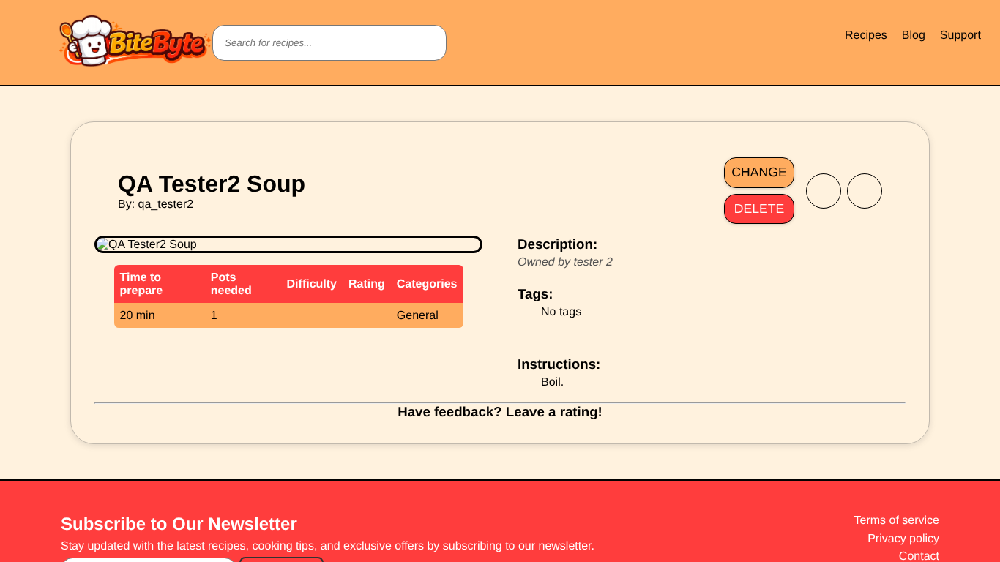
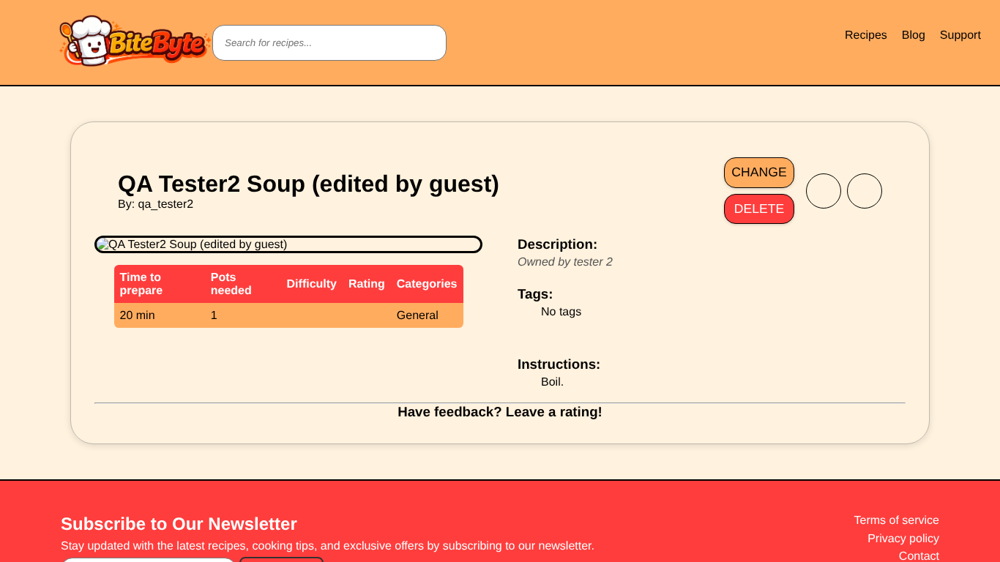

# BUG-001: Edit/delete: logged-out visitors can edit and delete any recipe

| Field | Value |
| --- | --- |
| Bug ID | BUG-001 |
| Related test case | ED-02, ED-03 |
| Module | Edit / delete recipe |
| Severity | Critical |
| Priority | High |
| Environment | E1 – Windows 11, Opera GX, XAMPP |
| Status | Open |
| Reported by | Kristijan Sarcevic |
| Date | 28.10.2026 |

## Preconditions

- Not logged in
- A recipe owned by another user exists (qa_tester2's "QA Tester2 Soup")

## Steps to reproduce

1. Open `php/details.php?id=<recipe id>` without logging in
2. Click **Change**, edit the title, click **Save Changes**
3. Open the same recipe again and click **Delete**, confirm

## Test data

Recipe: QA Tester2 Soup (owner qa_tester2)

## Expected result

Change and Delete are hidden for anyone who isn't the owner, and the server refuses edits and deletes from them.

## Actual result

Logged out, both buttons are visible on every recipe. Saving the edit form changed the title to "QA Tester2 Soup (edited by guest)", and Delete removed the recipe from the database. A logged-in non-owner is correctly blocked ("You do not have permission to edit this recipe!").

## Reproducibility

Always

## Attachments

## Notes

Cause is in `details.php`, `edit_recipe.php` and `delete_recipe.php`: `if (!isset($_SESSION['UsersID'])) { $has_permission = true; }` gives full permission to anyone who is NOT logged in. It also means the 22 seed recipes (no owner) can only be edited by guests.
