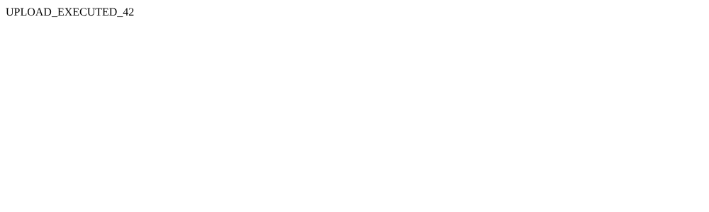

# BUG-002: Submit recipe: any file type is accepted as a photo, and uploaded .php files run on the server

| Field | Value |
| --- | --- |
| Bug ID | BUG-002 |
| Related test case | SR-05 |
| Module | Submit recipe |
| Severity | Critical |
| Priority | High |
| Environment | E1 – Windows 11, Opera GX, XAMPP |
| Status | Fixed (retested 29.10.2026) |
| Reported by | Kristijan Sarcevic |
| Date | 28.10.2026 |

## Preconditions

- Logged in

## Steps to reproduce

1. Open Submit recipe
2. In the file picker choose "All files" and select `probe.php` (or a GIF, or a text file renamed to `.jpg`)
3. Fill the required fields and submit
4. Open the saved file's URL: `img/recipe_images/<saved name>.php`

## Test data

probe.php: `<?php echo 'UPLOAD_EXECUTED_'.(6*7); ?>`
test.gif, fake.jpg (text file)

## Expected result

Only real PNG/JPEG images are accepted; other files are rejected by the server.

## Actual result

All three uploads succeed with "Recipe submitted successfully!". The .php file is saved with its .php extension and the server executes it: its URL returns `UPLOAD_EXECUTED_42`. The fake .jpg is saved and shows as a broken image.

## Reproducibility

Always

## Attachments

## Notes

The only check is the `accept="image/png,image/jpeg"` attribute, which is a suggestion to the file picker. The server keeps the original extension and never checks the file. This lets anyone with an account run their own code on the server.

## Fix and retest

**Fix:** `submit.php` and `edit_recipe.php` now check the uploaded file's content on the server with `getimagesize()`. Only real JPEG and PNG images are accepted, and they are saved with an extension the server chooses (`.jpg` / `.png`), never the original file name's. Rejected uploads show "Only JPG and PNG images are allowed as the recipe photo." and nothing is saved.

**Retest (29.10.2026, E1 and live site):**

| Upload | Result |
| --- | --- |
| probe.php | Rejected, recipe not saved, no file created |
| test.gif | Rejected |
| fake.jpg (text file) | Rejected |
| Real JPG / PNG | Accepted and shown (regression check SR-01, SR-04: Pass) |
| probe.php via Edit recipe | Rejected, old photo kept |

Status: **Fixed**
