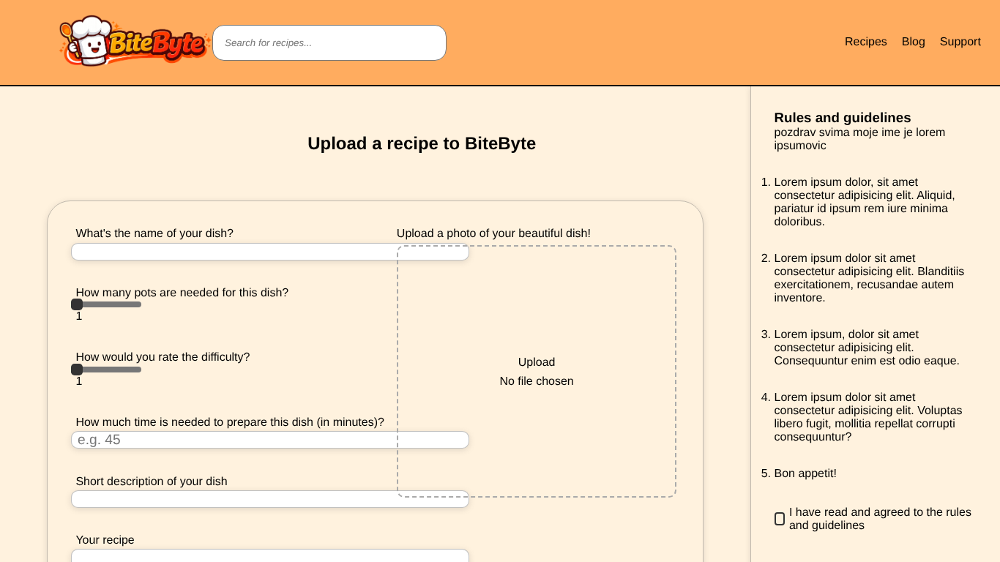

# BUG-004: Log out: there is no Log out button, and the header shows LOG IN / SIGN UP while logged in

| Field | Value |
| --- | --- |
| Bug ID | BUG-004 |
| Related test case | LI-06 |
| Module | Log in / log out |
| Severity | Major |
| Priority | High |
| Environment | E1 – Windows 11, Opera GX, XAMPP |
| Status | Open |
| Reported by | Kristijan Sarcevic |
| Date | 28.10.2026 |

## Preconditions

- Logged in as qa_tester1

## Steps to reproduce

1. Log in
2. Look at the header on Home, Recipes and Submit
3. Look for any Log out option

## Test data

qa.tester1@test.com / Test@1234

## Expected result

A Log out option is visible while logged in, and LOG IN / SIGN UP are hidden.

## Actual result

Header is the same as for guests: Recipes | Blog | Support | LOG IN | SIGN UP. There is no way to log out from the UI. Opening `php/logout.php` by hand does end the session.

## Reproducibility

Always

## Attachments

