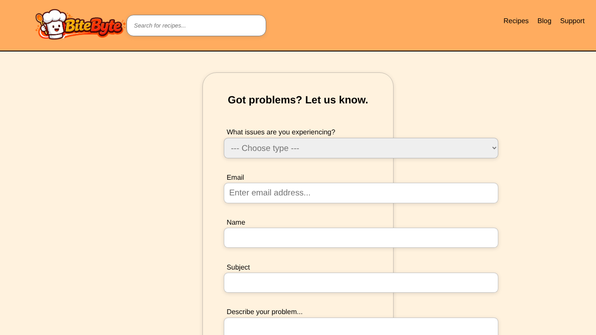

# BUG-005: Support and newsletter: forms don't send or save anything

| Field | Value |
| --- | --- |
| Bug ID | BUG-005 |
| Related test case | SP-01 (also SP-03) |
| Module | Support and newsletter |
| Severity | Major |
| Priority | Medium |
| Environment | E1 – Windows 11, Opera GX, XAMPP |
| Status | Open |
| Reported by | Kristijan Sarcevic |
| Date | 28.10.2026 |

## Preconditions

- On the Support page

## Steps to reproduce

1. Choose an issue type and fill Email, Name, Subject and the description
2. Click Submit
3. Check the support table (SQL check Q6)

## Test data

Type: Can't log in; Email: qa.tester1@test.com; Name: QA Tester

## Expected result

A confirmation is shown and the request is saved in the support table.

## Actual result

The page reloads with every field in the URL (`support.html?type=1&email=qa.tester1%40test.com&name=QA+Tester&...`). No confirmation; support table still has 0 rows. The newsletter form behaves the same way (`index.php?email=...`).

## Reproducibility

Always

## Attachments

## Notes

Both forms have `action=""` and no backend, even though a `support` table exists. Sending email addresses in the URL also leaves them in browser history and server logs.
