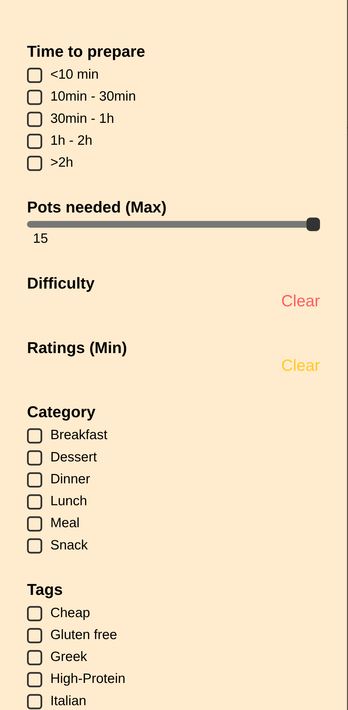

# BUG-006: Recipes (mobile): filter panel has no close button

| Field | Value |
| --- | --- |
| Bug ID | BUG-006 |
| Related test case | UI-04 |
| Module | UI and responsiveness |
| Severity | Major |
| Priority | Medium |
| Environment | E1 – Windows 11, Opera GX, XAMPP (mobile device view) |
| Status | Open |
| Reported by | Kristijan Sarcevic |
| Date | 28.10.2026 |

## Preconditions

- Phone-width screen (768 px or less)

## Steps to reproduce

1. Open Recipes
2. Tap the filter button
3. Try to close the panel without applying filters

## Test data

-

## Expected result

The panel has a visible close button that closes it.

## Actual result

The panel covers the whole screen with no close button, and page scrolling is locked. The only way out is Apply Filters.

## Reproducibility

Always

## Attachments

## Notes

Class name mismatch: the HTML button is `.close-filter` (hidden by `display:none`), while the mobile CSS styles and shows `.filter-close`, which no element uses.
