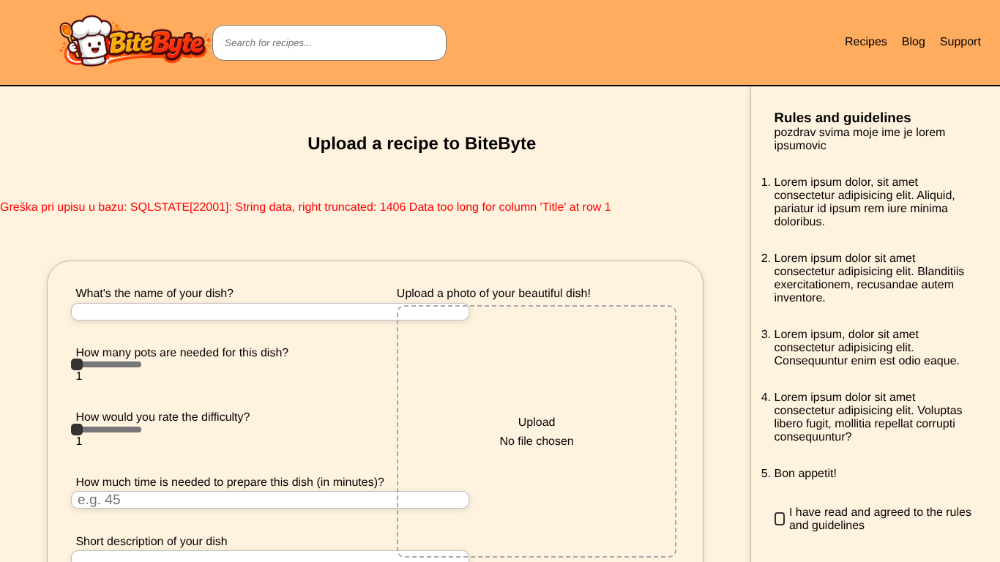

# BUG-007: Submit recipe: raw database error shown when the title is longer than 255 characters

| Field | Value |
| --- | --- |
| Bug ID | BUG-007 |
| Related test case | SR-10 |
| Module | Submit recipe |
| Severity | Minor |
| Priority | Medium |
| Environment | E1 – Windows 11, Opera GX, XAMPP |
| Status | Open |
| Reported by | Kristijan Sarcevic |
| Date | 28.10.2026 |

## Preconditions

- Logged in

## Steps to reproduce

1. Paste a 300-character title
2. Fill the other required fields and submit

## Test data

Title: 300 × 'a'

## Expected result

The title field limits input, or a clear error message is shown.

## Actual result

No limit on the field. Recipe is not saved, and the page shows: `Greška pri upisu u bazu: SQLSTATE[22001]: String data, right truncated: 1406 Data too long for column 'Title' at row 1`

## Reproducibility

Always

## Attachments

## Notes

Showing raw database errors also reveals table and column names. Adding `maxlength="255"` and a friendly server message would fix it.
