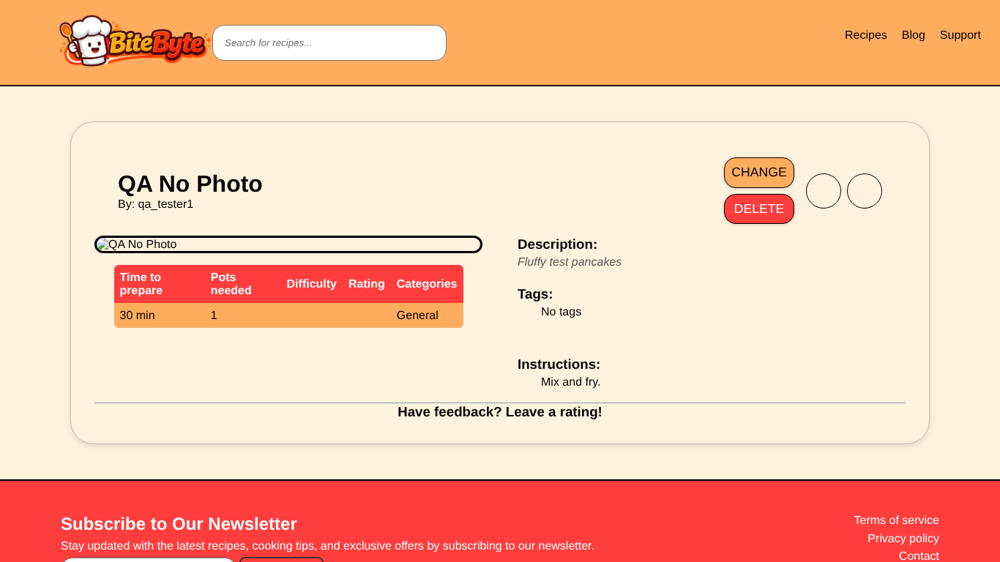

# BUG-008: Recipe without a photo shows a broken image

| Field | Value |
| --- | --- |
| Bug ID | BUG-008 |
| Related test case | SR-06 |
| Module | Submit recipe |
| Severity | Minor |
| Priority | Medium |
| Environment | E1 – Windows 11, Opera GX, XAMPP |
| Status | Open |
| Reported by | Kristijan Sarcevic |
| Date | 28.10.2026 |

## Preconditions

- Logged in

## Steps to reproduce

1. Submit a recipe with all required fields but no photo
2. Open it in the list and on its details page

## Test data

Title: QA No Photo

## Expected result

A placeholder image is shown.

## Actual result

ImageURL is saved as `default.png`, but `img/recipe_images/default.png` doesn't exist, so a broken image icon with alt text is shown.

## Reproducibility

Always

## Attachments

