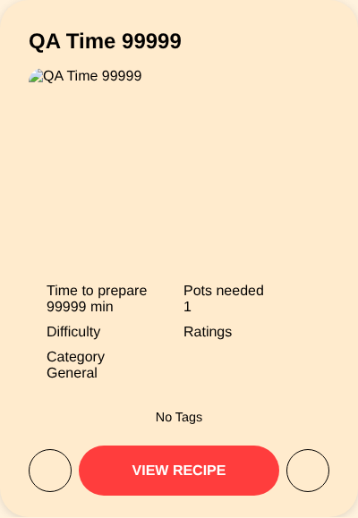

# BUG-009: Submit recipe: preparation time accepts unrealistic values, and 0/negative get a misleading message

| Field | Value |
| --- | --- |
| Bug ID | BUG-009 |
| Related test case | SR-07 |
| Module | Submit recipe |
| Severity | Minor |
| Priority | Low |
| Environment | E1 – Windows 11, Opera GX, XAMPP |
| Status | Open |
| Reported by | Kristijan Sarcevic |
| Date | 28.10.2026 |

## Preconditions

- Logged in

## Steps to reproduce

1. Submit a recipe with time 0, then -5, then 99999

## Test data

0, -5, 99999

## Expected result

0 and negative values are rejected with a clear message; unrealistic values are rejected or warned about.

## Actual result

0 and -5 are rejected by the server with "Molimo popunite sva obavezna polja (Naziv, Vreme, Recept)." ("please fill in all required fields"), although the field isn't empty. 99999 is accepted and the recipe shows 99999 minutes, appearing first when sorting by longest time.

## Reproducibility

Always

## Attachments

## Notes

The number field has no `min`/`max` attributes.
