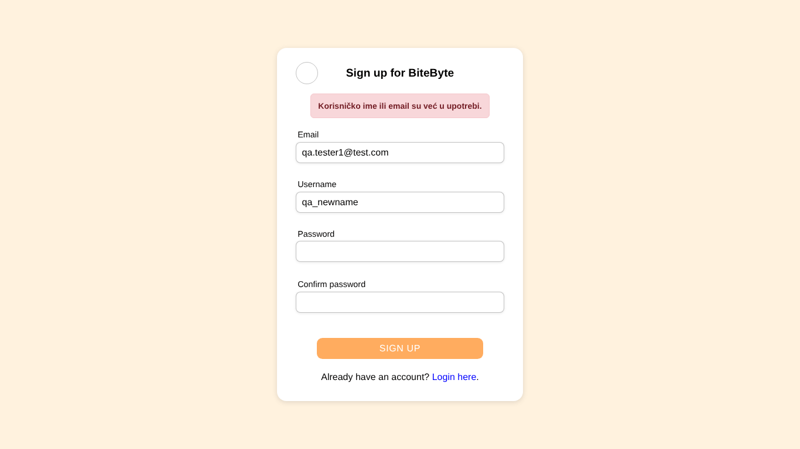

# BUG-010: Server error messages are in Serbian while the site is in English

| Field | Value |
| --- | --- |
| Bug ID | BUG-010 |
| Related test case | SU-16 |
| Module | Sign up / Log in / Submit recipe |
| Severity | Minor |
| Priority | Medium |
| Environment | E1 – Windows 11, Opera GX, XAMPP |
| Status | Open |
| Reported by | Kristijan Sarcevic |
| Date | 28.10.2026 |

## Preconditions

-

## Steps to reproduce

1. Register with an email that's already used
2. Log in with a wrong password
3. Submit a recipe with time 0

## Test data

-

## Expected result

All messages use English, like the rest of the UI.

## Actual result

Client-side messages are English ("Email is required"); server messages are Serbian: "Korisničko ime ili email su već u upotrebi.", "Pogrešan email ili lozinka.", "Molimo popunite sva obavezna polja...", "Greška pri upisu u bazu..."

## Reproducibility

Always

## Attachments

