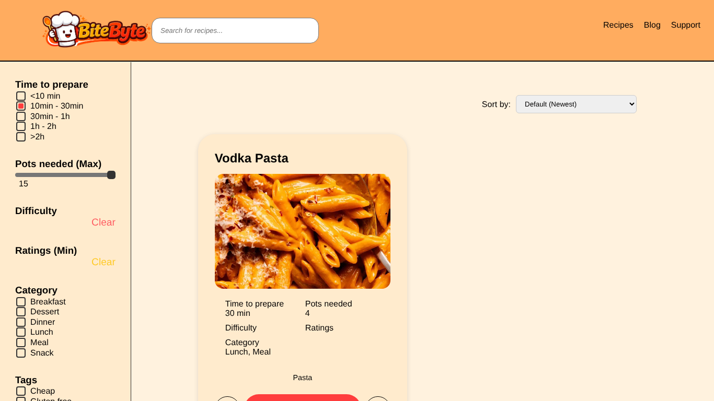

# BUG-013: Recipes: search box is cleared after applying filters

| Field | Value |
| --- | --- |
| Bug ID | BUG-013 |
| Related test case | RB-05 |
| Module | Browse and search |
| Severity | Minor |
| Priority | Low |
| Environment | E1 – Windows 11, Opera GX, XAMPP |
| Status | Open |
| Reported by | Kristijan Sarcevic |
| Date | 28.10.2026 |

## Preconditions

-

## Steps to reproduce

1. Search for `pasta`
2. Tick 10min – 30min and click Apply Filters

## Test data

pasta + 10–30 min

## Expected result

Results match both, and "pasta" stays in the search box.

## Actual result

Results are correct (the keyword is kept in a hidden field), but the search box is empty, so the user can't see the active search.

## Reproducibility

Always

## Attachments

